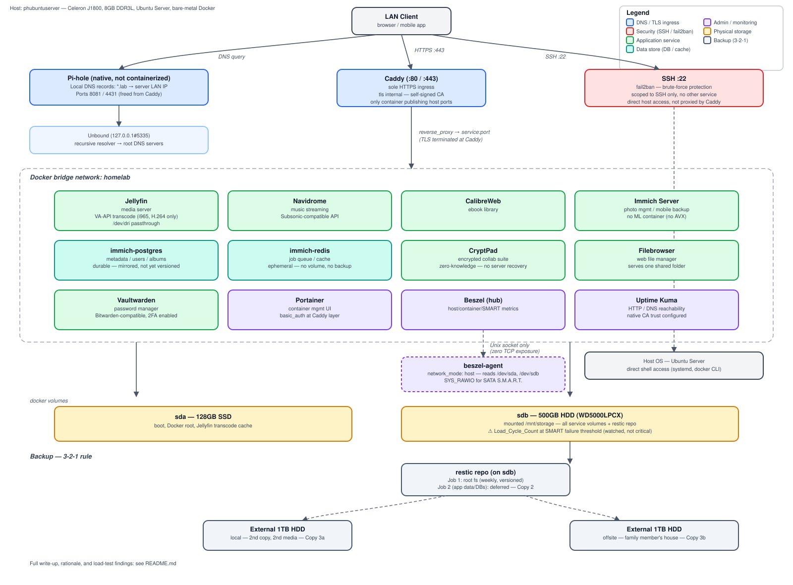

# phubuntuserver — Self-Hosted Homelab on Constrained Hardware

A Docker-based self-hosted services stack running on a Celeron J1800
(2013-era Bay Trail-D), documenting real architectural decisions, real
troubleshooting, and a structured performance-testing project — not a
tutorial copy-paste.

This repo intentionally leads with the hardware constraints rather than
hiding them. Most of the interesting engineering here came from working
*around* a dual-core, no-AVX, no-hyperthreading CPU with 8GB of RAM, not
from having generous headroom to work with.

---

## Architecture



```
LAN client
  │
  ├─► Pi-hole (native, DNS) ──► Unbound (recursive resolver)
  │      resolves *.lab domains → server LAN IP
  │
  └─► Caddy (ports 80/443, sole HTTPS ingress)
         │  tls internal (self-signed internal CA)
         │  reverse_proxy by Docker service name over the `homelab` bridge
         │
         ├─► jellyfin        (media server, VAAPI transcode)
         ├─► navidrome       (music streaming)
         ├─► calibreweb      (ebook library)
         ├─► immich-server   (photo management, no ML container — see below)
         │      └─► immich-postgres, immich-redis
         ├─► cryptpad        (encrypted collaborative office suite)
         ├─► filebrowser     (web file manager, one shared folder)
         ├─► vaultwarden     (self-hosted Bitwarden-compatible vault)
         ├─► portainer       (container management UI)
         ├─► beszel          (host/container/SMART metrics) ◄─ beszel-agent (host network)
         └─► uptime-kuma     (HTTP/DNS reachability monitoring)
```

**Only Caddy publishes a host port.** Every other service is reachable
exclusively through Caddy's reverse proxy over an internal Docker bridge
network — nothing bypasses TLS termination or per-request access logging.

---

## Hardware

| Component | Spec | Constraint it creates |
|---|---|---|
| CPU | Celeron J1800 (Bay Trail-D, 2013), dual-core, no Hyper-Threading, **no AVX** | Blocks TensorFlow-based ML features outright (Immich's ML container, PhotoPrism's face/classification models) — not a config choice, a hardware wall |
| RAM | 8GB DDR3L-1600 | `docker-compose.yml`'s summed `mem_limit` across all services sits at ~7.1GB — deliberately tight, sized against real usage, not padded |
| iGPU | Gen7, VAAPI-capable | **H.264 encode/decode only** — no HEVC/VP9/AV1 hardware path. Single VCS (video) engine *and* a shared RCS (render/copy) engine, both of which become contention points under concurrent transcodes (see [Load Testing](#load-testing--capacity-planning)) |
| Storage | 128GB SSD (boot/Docker root) + 500GB HDD (`/mnt/storage`, WD WD5000LPCX) | HDD's `Load_Cycle_Count` SMART attribute sits at its normalized failure threshold — traced to WD's aggressive idle3 head-parking firmware, not usage-driven wear (see below) |

---

## Key design decisions

**Caddy as sole ingress, with an internal CA.** No public domain is owned;
every service resolves under `*.lab` internally via Pi-hole, and Caddy
issues TLS certs from a self-signed internal CA (`tls internal`) rather
than serving plaintext HTTP on the LAN. Direct host-port publishing was
removed from every service except Caddy itself, closing a gap where
clients could bypass TLS and access logging entirely by hitting a
container's port directly.

**Host DNS deliberately *not* pointed at its own Pi-hole instance.**
Routing the host's own resolver through a Pi-hole container running on
that same host creates a circular single point of failure: if Pi-hole
goes down, the host loses DNS resolution for everything, including the
package-manager fetches needed to fix the problem. The host's resolver
stays on public DNS; only LAN *clients* (via DHCP) use Pi-hole. This is a
documented trade-off, not an oversight — see the Jul 9 entry in
[`docs/engineering-log.md`](./docs/engineering-log.md).

**Hardware transcode: VA-API + i965, not Quick Sync.** Bay Trail's iGPU
has never supported the `iHD` driver that Intel Quick Sync (QSV) requires
— forcing QSV in Jellyfin hardcodes `driver=iHD` into the ffmpeg command
and fails on every transcode attempt (`FFmpeg exited with code 251`),
regardless of whether the driver files themselves are intact. The fix was
switching Jellyfin's hardware acceleration setting to VA-API with
`LIBVA_DRIVER_NAME=i965`, which resolves correctly to the legacy `i965`
driver this 2013-era silicon actually supports.

**No `immich-machine-learning` container.** Immich's ML features (CLIP
smart search, facial recognition) have documented failures on non-AVX
CPUs. Rather than deploy it and let it crash-loop, it's omitted from the
compose file entirely — Immich runs here as a fast EXIF/metadata gallery
and mobile-backup target, the same practical ceiling PhotoPrism (its
predecessor in this stack) hit for the same hardware reason.

**fail2ban on the host, even on a LAN-only posture.** Scoped to SSH
specifically, not a blanket protection across every login surface — each
web application still relies on its own strong credentials (plus the
extra `basic_auth` layer in front of Portainer, below). Treated as cheap
defense-in-depth rather than something deferred until Tailscale exposure
changes the threat model.

**Two independently-keyed auth layers in front of Portainer.** Caddy's
`basic_auth` sits *in front of* Portainer's own login — a browser-native
credential prompt that has to be cleared before Portainer's UI even
loads. A leaked Portainer session cookie or an unpatched Portainer CVE
still hits this wall first, for the cost of one more password the admin
already knows. Not deployed elsewhere in the stack — proportionate to
Portainer's blast radius (full container control), not applied
indiscriminately.

**Uptime Kuma performs genuine certificate verification against the
internal CA, not a blanket TLS bypass.** Every `.lab` HTTPS monitor
initially ran with "Ignore TLS/SSL Error" enabled, which works but
disables certificate checking outright — a forged cert on the LAN would
go unnoticed. Fixed by mounting Caddy's `root.crt` into the container and
setting `NODE_EXTRA_CA_CERTS`, so Node.js trusts the same CA every other
client device does. Confirmed working: every monitor stayed green after
turning the bypass off.

**Beszel over Prometheus/cAdvisor/Netdata for monitoring.** Evaluated and
rejected on RAM/polling-overhead grounds given the 8GB ceiling. Beszel's
agent runs `network_mode: host` (for real interface stats) and
communicates with the hub exclusively over a Unix socket — zero TCP port
exposure for the metrics pipeline.

---

## Backup strategy

Two layers with different jobs: **restic** keeps point-in-time history of
the operating system, and **external-drive mirrors** protect the service
data against losing the server's disk entirely.

- **Working data** — every service's config, database and library lives
  on `/mnt/storage` (the 500GB HDD on `phubuntuserver` itself).
- **restic, root filesystem** — weekly systemd timer (Sunday ~04:00 UTC,
  `RandomizedDelaySec=1800`, `Persistent=true` so a run missed while the
  box was off catches up on next boot). Backs up `/` excluding
  `/mnt/storage` and pseudo-filesystems, retention `--keep-weekly 4
  --keep-monthly 6`, `Nice=19` / `IOSchedulingClass=idle` so it doesn't
  contend with Jellyfin/Immich.
- **External mirrors (offsite)** — two external 1TB 2.5" HDDs mirror all
  of `/mnt/storage`. One stays local; the other is kept at a family
  member's house, covering total loss of the server itself (fire, theft,
  hardware failure taking both internal disks at once).

**What this doesn't cover yet, stated plainly:**

- **No versioned backup of service data.** A second restic job for the
  app configs and databases on `/mnt/storage` is designed but deliberately
  deferred, since the external mirrors already hold a copy of that data.
  The trade-off is history: a mirror keeps only the latest state, so a
  corrupted database or an accidental deletion would be carried over on
  the next sync.
- **The restic repository sits on the same HDD as the data.** It protects
  against mistakes and bad updates, not against that disk failing — the
  external mirrors are what cover disk loss.
- When the second job lands, databases get dumped first (`pg_dumpall`
  for Immich's Postgres, a brief stop for the SQLite-backed services)
  rather than copying live database files, which can produce a backup
  that doesn't restore.

---

## Load testing & capacity planning

Rather than benchmark with synthetic tools (`stress-ng`, `fio`), this
project runs a tiered, real-usage load test — actual Jellyfin transcodes,
actual Immich imports, actual restic backups — because the real
bottleneck on this hardware isn't raw CPU throughput, it's the **shared
GPU engines** and the **HDD serving media reads**. A custom bash harness
([`scripts/capture-baseline_v4.sh`](./scripts/capture-baseline_v4.sh))
samples `mpstat`/`iostat`/`docker stats`/cgroup `cpu.stat`/`intel_gpu_top`
as a continuous time series across each test window, rather than a single
point-in-time snapshot — the difference mattered in practice: several
real throttling events were invisible in early single-snapshot captures
and only showed up once sampling became continuous. The tooling itself
went through four iterations to get there — see
[`case-studies/load-test-tooling-evolution.md`](./case-studies/load-test-tooling-evolution.md).

**Findings so far:**
- The **RCS (render/copy) engine saturates before the VCS (video encode)
  engine** under concurrent transcodes (68–97% busy vs. 42–61% at just 2
  streams) — the opposite of what the naive assumption ("VCS is the
  transcode bottleneck") predicted.
- At a realistic multi-device household load (2 concurrent transcodes + 1
  audio stream + background file transfer), **Navidrome's 0.5-core cgroup
  cap was the first real breakage point** — 7.3% of the test window spent
  cgroup-throttled — not a hardware ceiling, a config sizing mistake. Raising it to 0.75
  cores is planned, pending a re-test.
- Root-caused a SMART `Load_Cycle_Count` finding sitting at its normalized
  failure threshold on the HDD to WD's aggressive idle3 head-parking
  firmware (not usage-driven wear) by ruling out the generic ATA APM
  interface first and identifying the WD-proprietary idle3 timer as the
  actual mechanism.

---

## Notable troubleshooting

The full, dated build history — what got deployed, what broke, and how
it got fixed — lives in
[`docs/engineering-log.md`](./docs/engineering-log.md). The six
deepest write-ups are pulled out as standalone case studies:

- [Root-causing a months-long silent backup failure](./case-studies/restic-password-xxd-diagnosis.md) —
  every non-interactive restic auth method failed identically while
  manual entry always worked; the actual stored password differed from
  what manual typing (and prior notes) assumed by one character and a
  symbol, closed by capturing the literal bytes of a manual entry
  (`read -s -p ... | xxd`) rather than trusting the remembered value.
- [Hardware transcode failure on 2013-era iGPU silicon](./case-studies/jellyfin-vaapi-qsv-troubleshooting.md) —
  Quick Sync hardcodes a driver Bay Trail's GPU has never supported;
  fixed and verified at the GPU-engine level with VA-API + `i965`.
- [Reverse-proxy crash-loop from a stray quote](./case-studies/caddyfile-quote-crashloop.md) —
  Caddyfile syntax doesn't treat `'` as a string delimiter, corrupting a
  bcrypt hash from byte zero.
- [Container network name resolution bug](./case-studies/docker-network-name-resolution.md) —
  Compose auto-prefixes network names with the project directory
  (`docker_homelab`, not `homelab`), breaking an external one-off
  `docker run` join.
- [A SMART failure-threshold warning that wasn't usage wear](./case-studies/hdd-idle3-firmware-investigation.md) —
  traced to WD's proprietary idle3 head-parking timer, not the generic
  ATA APM interface most drives use.
- [Load-test tooling evolution, v1 → v4](./case-studies/load-test-tooling-evolution.md) —
  why moving from single-snapshot to continuous time-series sampling was
  the difference between catching real throttling events and missing
  them entirely.

---

## Stack

| Service | Image | Purpose |
|---|---|---|
| Jellyfin | `jellyfin/jellyfin:10.11.11` | Media server, VA-API hardware transcode |
| Navidrome | `deluan/navidrome:0.53.3` | Music streaming (Subsonic-compatible) |
| CalibreWeb | `linuxserver/calibre-web:0.6.21` | Ebook library |
| Immich | `immich-app/immich-server:release` + Postgres + Valkey | Photo management, mobile backup |
| CryptPad | `cryptpad/cryptpad:version-2026.5.0` | Encrypted collaborative office suite |
| Filebrowser | `filebrowser/filebrowser:v2.63.18` | Web file manager over the storage array |
| Vaultwarden | `vaultwarden/server:1.36.0` | Self-hosted password manager (Bitwarden-compatible) |
| Portainer | `portainer/portainer-ce:2.21.4` | Container management UI |
| Beszel + Beszel-agent | `henrygd/beszel:0.18.4` / `beszel-agent:alpine` | Host/container/SMART metrics |
| Uptime Kuma | `louislam/uptime-kuma:1.23.16` | HTTP/DNS reachability monitoring |
| Caddy | `caddy:2.9.1` | Reverse proxy, internal CA, sole TLS ingress |
| Pi-hole + Unbound | native, not containerized | DNS filtering + recursive resolution |

---

## Known limitations / honest trade-offs

- **Portainer currently mounts `/var/run/docker.sock` directly** (full
  access). A `docker-socket-proxy` re-implementation (read-mostly,
  capability-scoped) is planned once remote access via Tailscale goes
  live and changes the threat model — not yet done, tracked openly rather
  than hidden.
- **No VLAN segmentation.** The ISP-provided gateway has no 802.1Q
  capability; this requires dedicated router hardware (OPNsense/pfSense
  or UniFi/MikroTik) that isn't in the budget yet.
- **No versioned backup of service data yet** — external mirrors only;
  see [Backup strategy](#backup-strategy).
- **The HDD's idle3 fix isn't active yet.** The timer has been disabled
  in the drive's firmware settings, but the change only applies after a
  full power cycle (not a reboot), which hasn't happened yet.

---

## Roadmap

- Kaby Lake mini-PC upgrade (i5-7200U/8250U target) — unlocks Quick Sync
  HEVC hardware transcode, AVX2 (re-enables Immich/PhotoPrism-class ML
  features), and Proxmox virtualization instead of bare-Docker.
- Tailscale (subnet-router mode) for remote access to a subset of
  services, layered on top of the existing Caddy/Pi-hole setup.
- `docker-socket-proxy` re-implementation ahead of the Tailscale rollout.
- Second restic job for `/mnt/storage` service data, with database dumps
  taken before each run.
- Raise Navidrome's CPU cap and re-run the concurrent-load tier.

---

## Running this yourself

Repo contents:

```
docker-compose.yml
Caddyfile
README.md
architecture-diagram.svg
.env.example
.gitignore
scripts/
└── capture-baseline_v4.sh       # time-series load-test capture harness
docs/
├── engineering-log.md           # dated build history, phased, linked to case studies
└── rebuild-runbook.md           # full architecture & disaster-recovery runbook
case-studies/
├── restic-password-xxd-diagnosis.md
├── jellyfin-vaapi-qsv-troubleshooting.md
├── caddyfile-quote-crashloop.md
├── docker-network-name-resolution.md
├── hdd-idle3-firmware-investigation.md
└── load-test-tooling-evolution.md
```

```bash
git clone <this-repo>
cd <this-repo>
cp .env.example .env
# fill in .env with your own values — see .env.example for what's required
```

Before first boot, generate your own Portainer `basic_auth` credential and
drop it into the `Caddyfile`'s `portainer.lab` block (placeholders
`<ADMIN_USER>` / `<BCRYPT_HASH>` are there by default):
```bash
docker run --rm caddy:2.9.1 caddy hash-password --plaintext '<your-password>'
```
**Don't wrap the resulting hash in single quotes in the Caddyfile** —
Caddyfile syntax doesn't treat `'` as a string delimiter, so it becomes a
literal character prepended to the hash and crash-loops the container
with `illegal base64 data at input byte 0`. No quotes are needed at all,
since the hash has no spaces.

```bash
docker compose up -d
```

You'll also need to trust the generated internal CA on any client device
that needs HTTPS access to the `*.lab` domains — Windows/iOS/Android/
Firefox each need it installed slightly differently:
- **Windows**: Local Machine store → Trusted Root Certification Authorities
- **iOS**: install the profile, then *also* flip full trust under
  Settings → General → About → Certificate Trust Settings
- **Android**: Settings → Security → Install a certificate → CA certificate
- **Firefox**: ignores the OS trust store by default — flip
  `security.enterprise_roots.enabled` in `about:config`, or import the
  cert directly into Firefox's own Authorities tab

Pull the CA once Caddy is up: `docker exec caddy cat /data/caddy/pki/authorities/local/root.crt`

**Nothing in this repo — file or history — should contain a real secret.**
All credentials are `${VAR}` references resolved from a gitignored `.env`
at deploy time.
